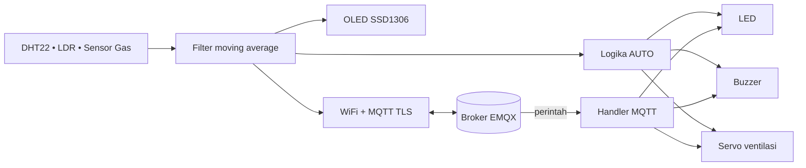

# ESP32 Air Quality & Temperature Detector

Simulasi **Wokwi** berbasis **ESP32 DevKit C V4 (MicroPython)** untuk memantau suhu,
kelembapan, intensitas cahaya, dan kualitas udara secara real-time. Data ditampilkan
di OLED 128x64, dikirim ke broker MQTT (EMQX) melalui TLS, dan dipakai untuk
mengendalikan LED, buzzer alarm, serta ventilasi otomatis (servo).

> Proyek ini adalah simulasi/eksperimen edukasi, bukan firmware produksi.

## Fitur

- 📊 Pembacaan 4 parameter: suhu, kelembapan, cahaya, dan kadar gas/polusi udara
- 🧹 Filter **moving average** 3 sampel untuk meredam fluktuasi sensor
- 🖥️ Tampilan live di OLED SSD1306 128x64 (I2C)
- ☁️ Publish telemetri JSON ke MQTT over TLS (port 8883) setiap 5 detik
- 🎛️ Kendali remote via MQTT: LED, ventilasi, dan perpindahan mode
- 🤖 Mode **AUTO**: LED + buzzer alarm + ventilasi otomatis berdasarkan sensor
- 🕹️ Mode **MANUAL**: aktuator hanya berubah saat menerima perintah
- 🔁 Auto-reconnect WiFi dan broker MQTT
- 🧠 Semua logika berjalan lokal di ESP32 (edge computing), tanpa cloud rule engine

## Komponen & Wiring

| Komponen | Pin Modul | Pin ESP32 | GPIO | Catatan |
|---|---|---|---|---|
| DHT22 (suhu & kelembapan) | VCC / GND / SDA | 3V3 / GND / D15 | 15 | Data 1-wire |
| OLED SSD1306 128x64 | VCC / GND / SCL / SDA | 3V3 / GND / D22 / D21 | 22, 21 | I2C alamat `0x3C` |
| LDR (photoresistor) | VCC / GND / AO | 3V3 / GND / D34 | 34 | ADC1, input-only |
| Gas sensor (MQ) | VCC / GND / AOUT | 3V3 / GND / D35 | 35 | ADC1, input-only |
| LED merah + resistor 220 Ω | A → GPIO, C → resistor → GND | D2 | 2 | Indikator status |
| Servo (ventilasi) | V+ / GND / PWM | 5V / GND / D18 | 18 | PWM 50 Hz |
| Buzzer | 1 (GND) / 2 (sinyal) | GND / D19 | 19 | Digerakkan PWM |

> Wiring lengkap ada di [`diagram.json`](diagram.json). Pada board fisik, gunakan
> catu daya 5V terpisah untuk servo agar ESP32 tidak *brownout*; GND harus disatukan.

## Arsitektur Singkat



Alur utama:

1. Setiap 5 detik sensor dibaca dan dihaluskan dengan moving average.
2. Nilai ditampilkan di OLED dan dipublikasikan sebagai JSON.
3. Jika mode `AUTO`, firmware menjalankan aturan lokal untuk LED, buzzer, dan servo.
4. Perintah MQTT dapat mengubah aktuator dan memindahkan sistem ke mode `MANUAL`.

## Konfigurasi

Semua konfigurasi ada di bagian atas [`main.py`](main.py):

```python
WIFI_SSID   = "Wokwi-GUEST"          # jaringan virtual Wokwi
WIFI_PASS   = ""

BROKER_HOST = "<host broker EMQX>"
BROKER_PORT = 8883                   # MQTT over TLS
BROKER_USER = "<username>"
BROKER_PASS = "<password>"

DEVICE_NAME = "esp32-lab-01"
```

`DEVICE_NAME` menentukan kedua topik MQTT. Ganti nilainya jika menjalankan lebih dari
satu perangkat pada broker yang sama.

| Parameter | Nilai |
|---|---|
| Interval publish | 5 detik |
| Ukuran filter | 3 sampel terakhir |
| Broker | EMQX, TLS (`ssl=True`) |
| Client ID | `ESP32-<unique_id>` |
| Keepalive | 60 detik |
| Resolusi ADC | 12-bit, atenuasi 11 dB |

## Skema MQTT

| Keperluan | Topik | Arah | Payload |
|---|---|---|---|
| Telemetri | `iot/esp32-lab-01/telemetry` | ESP32 → broker | JSON |
| Kendali | `iot/esp32-lab-01/cmd/led` | broker → ESP32 | teks perintah |

Contoh payload telemetri:

```json
{
  "temperature": 28.5,
  "humidity": 65,
  "light": 3120,
  "air_quality": 980,
  "air_status": "BAIK",
  "led": "OFF",
  "vent": "CLOSED",
  "mode": "AUTO"
}
```

Keterangan field:

| Field | Tipe | Keterangan |
|---|---|---|
| `temperature` | float | Suhu rata-rata (°C), 1 desimal |
| `humidity` | int | Kelembapan rata-rata (%), dibulatkan |
| `light` | int | `4095 - ADC` LDR; makin besar = makin terang |
| `air_quality` | int | Nilai mentah ADC sensor gas; makin besar = makin terpolusi |
| `air_status` | string | `BAIK`, `SEDANG`, atau `BURUK` |
| `led` | string | `ON` / `OFF` |
| `vent` | string | `OPEN` / `CLOSED` |
| `mode` | string | `AUTO` / `MANUAL` |

## Perintah Kendali

Kirim teks (huruf besar/kecil sama-sama diterima) ke topik
`iot/esp32-lab-01/cmd/led`:

| Perintah | Efek | Mode setelah perintah |
|---|---|---|
| `ON` | LED menyala | `MANUAL` |
| `OFF` | LED mati, buzzer mati | `MANUAL` |
| `VENT_OPEN` | Servo ke 90°, ventilasi terbuka | `MANUAL` |
| `VENT_CLOSE` | Servo ke 0°, ventilasi tertutup | `MANUAL` |
| `MODE_AUTO` | Aturan otomatis aktif kembali | `AUTO` |
| `MODE_MANUAL` | Aturan otomatis berhenti, buzzer mati | `MANUAL` |

Catatan:

- Perintah `ON`, `OFF`, `VENT_OPEN`, dan `VENT_CLOSE` otomatis memindahkan sistem ke
  `MANUAL`. Aktuator lain tetap pada posisi terakhir sampai diperintah atau mode
  dikembalikan ke `AUTO`.
- Saat kembali ke `AUTO`, aktuator baru disesuaikan pada siklus pembacaan berikutnya
  (maksimal ±5 detik).
- Mode tidak disimpan ke flash; reset board akan kembali ke `AUTO`.

## Logika Otomatis (Mode AUTO)

| Aktuator | Kondisi | Aksi |
|---|---|---|
| LED | `suhu > 30.0 °C` **atau** `air_quality >= 2500` | Menyala |
| Buzzer | Pemicu LED yang sama | Bunyi 1500 Hz jika udara `BURUK`, 900 Hz jika hanya suhu tinggi |
| Ventilasi | `air_quality >= 2500` **atau** `suhu > 32.0 °C` | Servo 90° (`OPEN`) |
| Semua | Kondisi normal | LED & buzzer mati, servo 0° (`CLOSED`) |

Saat boot: LED mati, buzzer mati, servo 0°, mode `AUTO`.

## Ambang Batas Kualitas Udara

| Rentang ADC | Status |
|---|---|
| `< 1200` | `BAIK` |
| `1200 – 2499` | `SEDANG` |
| `>= 2500` | `BURUK` |

## Cara Menjalankan

1. Buka [Wokwi](https://wokwi.com) → **New Project** → **ESP32 (MicroPython)**.
2. Salin isi [`diagram.json`](diagram.json) ke tab `diagram.json`.
3. Salin isi [`main.py`](main.py) ke tab `main.py`.
4. Isi `BROKER_HOST`, `BROKER_USER`, dan `BROKER_PASS` dengan kredensial broker EMQX
   kamu (port TLS `8883`).
5. Klik **▶ Start Simulation**. OLED akan menampilkan status koneksi, lalu data sensor.
6. Buka MQTT client (misalnya [MQTTX](https://mqttx.app/)), hubungkan ke broker dengan
   TLS dan kredensial yang sama, lalu subscribe ke topik telemetri.
7. Uji kendali dengan publish `VENT_OPEN`, `ON`, `OFF`, `MODE_AUTO`, dan sebagainya ke
   topik perintah.
8. Pantau log `[CMD MASUK]` dan `[PUB]` di Serial Monitor.

> `Wokwi-GUEST` hanya tersedia di simulator Wokwi. Untuk board fisik, ganti dengan
> SSID dan password WiFi asli.

## Struktur Proyek

```
.
├── diagram.json   # Skema rangkaian Wokwi (komponen + koneksi)
├── main.py        # Firmware MicroPython (sensor, OLED, aktuator, MQTT)
└── README.md
```

`main.py` memakai `umqtt.simple`. Jika muncul
`ImportError: no module named 'umqtt'`, tambahkan library `umqtt.simple` melalui
Library Manager Wokwi atau salin `umqtt/simple.py` dari
[micropython-lib](https://github.com/micropython/micropython-lib) ke proyek.

## Troubleshooting

| Gejala | Kemungkinan penyebab / solusi |
|---|---|
| OLED blank | Cek alamat I2C `0x3C`, SCL di GPIO22, SDA di GPIO21, dan koneksi 3V3 |
| `OSError` saat baca DHT | Pembacaan gagal sesekali; siklus tersebut dilewati dan dicoba lagi 5 detik kemudian |
| MQTT gagal connect | Pastikan host/port `8883`, kredensial benar, listener TLS aktif, dan WiFi tersambung |
| Servo bergetar / board restart | Servo butuh arus besar; pakai catu 5V terpisah dan satukan GND |
| Buzzer tidak berbunyi | Gunakan buzzer tipe pasif (digerakkan PWM) dan cek polaritas pin |
| Perintah diabaikan | Pastikan topik sama dengan `iot/<DEVICE_NAME>/cmd/led` dan payload berupa teks |
| Nilai sensor lambat berubah | Normal: interval 5 detik + rata-rata 3 sampel |
| Otomasi tidak jalan | Sistem mungkin masih `MANUAL`; kirim `MODE_AUTO` |

## ⚠️ Catatan Keamanan

Kredensial broker saat ini **hardcoded** di `main.py` dan sudah ikut ter-push ke
repositori publik. Sebaiknya:

- **Rotate/ganti password** broker EMQX sekarang, karena nilai lama sudah terekspos.
- Pindahkan kredensial ke `config.py` yang masuk `.gitignore`, lalu import di `main.py`.
- Gunakan akun/perangkat khusus dengan hak akses terbatas (ACL per topik), bukan akun
  utama broker.
- Jika repo publik, pertimbangkan membersihkan riwayat Git atau menganggap kredensial
  lama sudah tidak berlaku.

## Ide Pengembangan

- Bridge Telegram bot untuk notifikasi dan kendali dari chat
- Simpan telemetri ke InfluxDB/PostgreSQL lalu visualisasikan di Grafana
- Tambah sensor tambahan (CO₂, PM2.5) dan kalibrasi ambang gas
- Ganti `umqtt.simple` dengan `umqtt.robust` untuk koneksi yang lebih tahan putus
