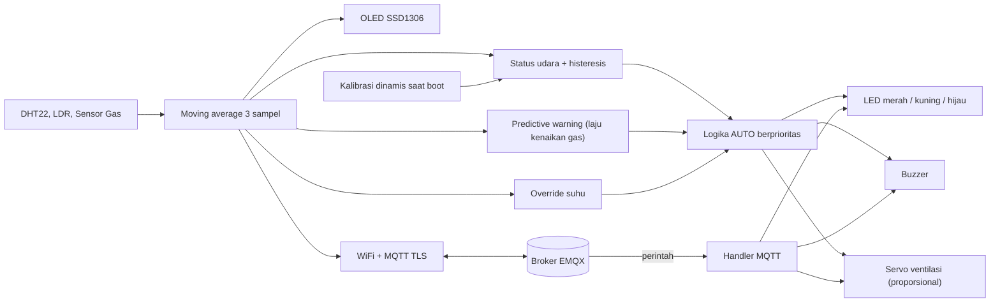

# ESP32 Air Quality & Temperature Detector

Simulasi **Wokwi** berbasis **ESP32 DevKit C V4 (MicroPython)** untuk memantau suhu,
kelembapan, intensitas cahaya, dan kualitas udara secara real-time. Data ditampilkan
di OLED 128x64, dikirim ke broker MQTT (EMQX) melalui TLS, dan dipakai untuk
mengendalikan LED tiga warna, buzzer alarm, serta ventilasi otomatis (servo).

> [!NOTE]
> Proyek ini adalah simulasi/eksperimen edukasi, bukan firmware produksi.

## Fitur

- Pembacaan 4 parameter: suhu, kelembapan, cahaya, dan kadar gas/polusi udara
- Filter **moving average** 3 sampel untuk meredam fluktuasi sensor
- Tampilan live di OLED SSD1306 128x64 (I2C)
- Publish telemetri JSON ke MQTT over TLS (port 8883) setiap 5 detik
- Kendali remote via MQTT: LED, ventilasi, dan perpindahan mode
- Mode **AUTO**: LED, buzzer, dan ventilasi diatur otomatis oleh logika berprioritas
- Mode **MANUAL**: aktuator hanya berubah saat menerima perintah, dengan timeout otomatis
  kembali ke AUTO
- Reconnect WiFi dan MQTT **non-blocking**: kontrol lokal tetap berjalan walau jaringan putus
- Semua logika berjalan lokal di ESP32 (edge computing), tanpa cloud rule engine

## Komponen & Wiring

| Komponen | Pin Modul | Pin ESP32 | GPIO | Catatan |
|---|---|---|---|---|
| DHT22 (suhu & kelembapan) | VCC / GND / SDA | 3V3 / GND / D15 | 15 | Data 1-wire |
| OLED SSD1306 128x64 | VCC / GND / SCL / SDA | 3V3 / GND / D22 / D21 | 22, 21 | I2C alamat `0x3C` |
| LDR (photoresistor) | VCC / GND / AO | 3V3 / GND / D34 | 34 | ADC1, input-only |
| Gas sensor (MQ) | VCC / GND / AOUT | 3V3 / GND / D35 | 35 | ADC1, input-only |
| LED merah + resistor 220 Ω | A → GPIO, C → resistor → GND | D2 | 2 | Status BURUK |
| LED kuning + resistor 220 Ω | A → GPIO, C → resistor → GND | D4 | 4 | Status SEDANG / warning (berkedip) |
| LED hijau + resistor 220 Ω | A → GPIO, C → resistor → GND | D5 | 5 | Status BAIK |
| Servo (ventilasi) | V+ / GND / PWM | 5V / GND / D18 | 18 | PWM 50 Hz, 0° tertutup, 180° terbuka penuh |
| Buzzer | 1 (GND) / 2 (sinyal) | GND / D19 | 19 | Digerakkan PWM |

> [!TIP]
> Wiring lengkap ada di [`diagram.json`](diagram.json). Pada board fisik, gunakan
> catu daya 5V terpisah untuk servo agar ESP32 tidak *brownout*; GND harus disatukan.

## Arsitektur Singkat

Alur utama:

1. Saat boot, sistem mengambil baseline gas selama sekitar 3 detik dan menghitung threshold.
2. Setiap 1 detik sensor dibaca dan dihaluskan dengan moving average.
3. Status udara dihitung (dengan histeresis) dan laju kenaikan gas dipantau.
4. Jika mode `AUTO`, logika berprioritas mengatur LED, buzzer, dan servo.
5. Setiap 5 detik nilai dipublikasikan sebagai JSON. OLED diperbarui setiap pembacaan.
6. Perintah MQTT dapat mengubah aktuator dan memindahkan sistem ke mode `MANUAL`.
